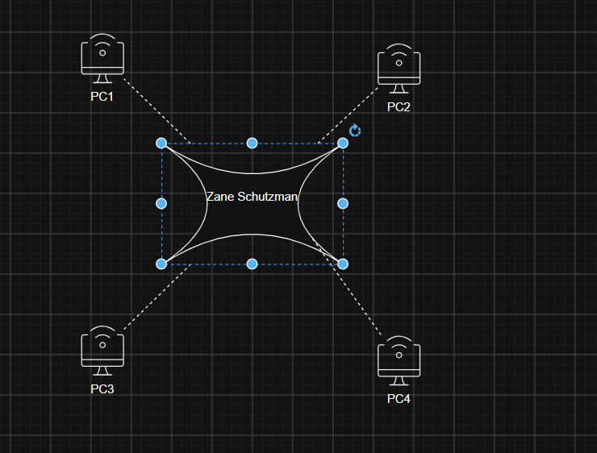

# Week 3 - Tutorial 3

## Task 1: View ARP Table

For this task, I used PowerShell to view my ARP table using the `Get-NetNeighbor` command. ARP stands for Address Resolution Protocol. ARP is used to find the MAC address associated with an IP address on a local network. This allows devices on the same LAN to communicate with each other.

Evidence: [Task 1 ARP.png](images/tut3/Task%201%20ARP.png)

My Wi-Fi adapter was using Interface Index 19. I communicated with another device on the LAN by using the `ping` command. The device responded successfully and then appeared in my ARP table as Reachable.

The first other device I discovered was:

IP Address: 10.233.136.80

MAC Address: C6-E4-2B-67-B3-B5

State: Reachable

I know this device was another computer because I successfully pinged the IP address. I received four replies with 0% packet loss. After communicating with the device, its MAC address appeared in my ARP table as Reachable.

I also discovered another Reachable device after connecting my computer to my phone's hotspot.

MAC Address: 76-42-18-10-B8-64

State: Reachable

I believe this device was associated with my phone's hotspot because it appeared after I connected my computer to the hotspot and generated network traffic.

Evidence: [task 1 arp phone.png](images/tut3/task%201%20arp%20phone.png)

---

## Task 2: Draw Network Diagrams

For this task, I used diagrams.net to create two network diagrams.

### Diagram 1

The first diagram shows a switched LAN with one switch and four PCs. Each PC is connected directly to Switch 1.

The computers are labeled PC 1, PC 2, PC 3, and PC 4. The switch is labeled Switch 1. My name is also included on the diagram.

Evidence: [diagram.png](images/tut3/diagram.png)

The original diagrams.net file was saved as `network-diagram-1.drawio`.

### Diagram 2

The second diagram shows a switched LAN with eight PCs and three switches. PC 1, PC 2, PC 3, and PC 4 are connected to Switch 1. PC 5, PC 6, PC 7, and PC 8 are connected to Switch 2.

Switch 1 and Switch 2 are connected to Switch 3. Switch 3 is the center switch, creating the required star topology. My name is also included on the diagram.

Evidence: [multi diagram.png](images/tut3/multi%20diagram.png)

The original diagrams.net file was saved as `network-diagram-2.drawio`.

---

## Task 4: Learning Reflection

During the first three weeks, I learned and used several networking tools and commands.

PowerShell

Get-NetAdapter

Get-NetIPConfiguration

Get-NetIPAddress

Get-NetRoute

Get-NetNeighbor

Test-NetConnection

Test-Connection

Resolve-DnsName

Speedtest

diagrams.net

One tool that I think will be useful outside of this unit is PowerShell. PowerShell can be used to check computer and network information and troubleshoot problems. I could use PowerShell outside of this class to troubleshoot my own computer or network connection. For example, I could use `Get-NetIPConfiguration` to check my network settings or `Test-NetConnection` to test whether my computer can communicate with another device.

Learning PowerShell is useful because it allows me to get information about my computer and network without having to use multiple graphical tools.
