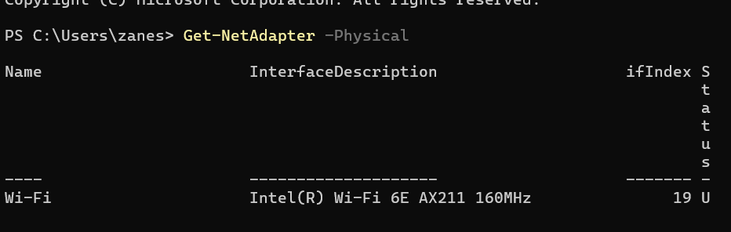

# Week 4 - Tutorial 4

## Task 1: View Routing Table

### Evidence: Network Adapter



I used the following command to view my physical network adapters:

```powershell
Get-NetAdapter -Physical

My primary physical network adapter was Wi-Fi, with an interface index of 19.

Evidence: Routing Table

I used the following command to view the routing table for my primary interface:

Get-NetRoute -InterfaceIndex 19
How to Read Each Row
Destination Prefix	Next Hop	Description
255.255.255.255/32	0.0.0.0	This is the IPv4 limited broadcast address. It is used to send traffic to all devices on the local network.
224.0.0.0/4	0.0.0.0	This is the IPv4 multicast range. It is used for sending traffic to groups of devices.
10.233.159.255/32	0.0.0.0	This is the broadcast address for the local 10.233.128.0/19 network.
10.233.134.17/32	0.0.0.0	This is a specific host route for one individual IP address.
10.233.128.0/19	0.0.0.0	This represents the local network directly connected to my computer.
0.0.0.0/0	10.233.128.1	This is the default route. It is used when there is no more specific route available.

The /19 network covers the address range from 10.233.128.0 through 10.233.159.255.

Task 2: Trace Path Through the Internet
Harvard University

I used the following command:

tracert www.harvard.edu

The trace reached the destination in 15 hops. The final three responses were approximately 9 ms, 6 ms, and 6 ms, giving an approximate average RTT of 7 ms.

Some of the network providers that appeared in the trace included Zayo and Lumen. Several router names included bwi9, iad93, and wdc12, which may indicate network locations in the Baltimore/Washington, D.C. area.

There were several Request timed out responses, but the trace still reached the final destination. This shows that some routers did not respond to traceroute requests even though traffic continued through the network.

Stanford University

I used the following command:

tracert www.stanford.edu

The trace reached the destination in 17 hops. The final responses were approximately 8 ms, 6 ms, and 11 ms, giving an approximate average RTT of 8 ms.

Zayo appeared in several of the early hops. The final hostname included awsglobalaccelerator.com, which indicates that the destination was reached through AWS Global Accelerator infrastructure.

There were many timeouts between the early Zayo hops and the final destination. However, the final hop responded, so the trace was successful.

Oxford University

I used the following command:

tracert www.ox.ac.uk

The trace reached the destination in 13 hops. The final responses were approximately 46 ms, 28 ms, and 7 ms, giving an approximate average RTT of 27 ms.

Zayo appeared in several of the hops. The destination resolved to www.ox.ac.uk.cdn.cloudflare.net, showing that the trace ended at Cloudflare infrastructure rather than necessarily reaching a physical server located at Oxford University.

There were several timeouts in the middle of the trace, but the destination was still reached successfully.

Traceroute Comparison
Destination	Hops	Approx. Final RTT	Network Providers/Infrastructure
Harvard	15	~7 ms	Zayo, Lumen
Stanford	17	~8 ms	Zayo, AWS Global Accelerator
Oxford	13	~27 ms	Zayo, Cloudflare

The number of hops does not directly determine the amount of delay. For example, Oxford had fewer hops than Stanford but had a higher average RTT. Delay can be affected by physical distance, routing paths, congestion, and the networks being used.

What I Learned from the International Destination

The Oxford traceroute showed that traffic can travel through multiple different networks before reaching a destination. It also showed that websites may use services such as Cloudflare, meaning the final IP address does not necessarily represent the physical location of the organization.

Compared with the Harvard and Stanford traces, the Oxford trace had a higher RTT. Distance between networks can contribute to higher latency, but routing, congestion, and the particular network infrastructure being used can also affect the result.

Task 3: IP Address Lookup
Loyola Network

I used an online IP lookup service to see what information could be identified about my network.

The results showed:

ISP: Loyola University Maryland
Country: United States
State/Region: Maryland
City: Baltimore
ASN: 36413
Services: None detected

I did not include my actual IP address because it is not necessary for the journal.

Second Network

I repeated the IP lookup using a second network through my phone.

The results showed:

ISP: AT&T Enterprises LLC
Country: United States
State/Region: Virginia
City: Richmond
ASN: 7018
Services: None detected
IP Lookup Comparison
	Loyola Network	Second Network
ISP	Loyola University Maryland	AT&T Enterprises LLC
Country	United States	United States
State/Region	Maryland	Virginia
City	Baltimore	Richmond
ASN	36413	7018

The two networks produced different geographic information and different ISPs. This shows that IP addresses can be associated with different networks and approximate geographic locations.

IP geolocation is not necessarily an exact representation of where a device is physically located. The location shown can represent the location associated with the ISP, network, or IP address rather than the exact location of the device.

DB-IP Lite Database

I also downloaded the **DB

Here is the whole Tutorial 4 Markdown with the image links changed to match the exact style that works in your Tutorial 3:

# Week 4 - Tutorial 4

## Task 1: View Routing Table

### Evidence: Network Adapter


I used the following command to view my physical network adapters:

```powershell
Get-NetAdapter -Physical

My primary physical network adapter was Wi-Fi, with an interface index of 19.

Evidence: Routing Table

I used the following command to view the routing table for my primary interface:

Get-NetRoute -InterfaceIndex 19
How to Read Each Row
Destination Prefix	Next Hop	Description
255.255.255.255/32	0.0.0.0	This is the IPv4 limited broadcast address. It is used to send traffic to all devices on the local network.
224.0.0.0/4	0.0.0.0	This is the IPv4 multicast range. It is used for sending traffic to groups of devices.
10.233.159.255/32	0.0.0.0	This is the broadcast address for the local 10.233.128.0/19 network.
10.233.134.17/32	0.0.0.0	This is a specific host route for one individual IP address.
10.233.128.0/19	0.0.0.0	This represents the local network directly connected to my computer.
0.0.0.0/0	10.233.128.1	This is the default route. It is used when there is no more specific route available.

The /19 network covers the address range from 10.233.128.0 through 10.233.159.255.

Task 2: Trace Path Through the Internet
Harvard University

I used the following command:

tracert www.harvard.edu

The trace reached the destination in 15 hops. The final three responses were approximately 9 ms, 6 ms, and 6 ms, giving an approximate average RTT of 7 ms.

Some of the network providers that appeared in the trace included Zayo and Lumen. Several router names included bwi9, iad93, and wdc12, which may indicate network locations in the Baltimore/Washington, D.C. area.

There were several Request timed out responses, but the trace still reached the final destination. This shows that some routers did not respond to traceroute requests even though traffic continued through the network.

Stanford University

I used the following command:

tracert www.stanford.edu

The trace reached the destination in 17 hops. The final responses were approximately 8 ms, 6 ms, and 11 ms, giving an approximate average RTT of 8 ms.

Zayo appeared in several of the early hops. The final hostname included awsglobalaccelerator.com, which indicates that the destination was reached through AWS Global Accelerator infrastructure.

There were many timeouts between the early Zayo hops and the final destination. However, the final hop responded, so the trace was successful.

Oxford University

I used the following command:

tracert www.ox.ac.uk

The trace reached

Pasted markdown(2).md
File
redo this markdown with that change 

Absolutely. I used the Markdown you uploaded and changed only the image links to the same format as your working Tutorial 3 example:


Here is the complete corrected Markdown:

# Week 4 - Tutorial 4

## Task 1: View Routing Table

### Evidence: Network Adapter


I used the following command to view my physical network adapters:

```powershell
Get-NetAdapter -Physical

My primary physical network adapter was Wi-Fi, with an interface index of 19.

Evidence: Routing Table

I used the following command to view the routing table for my primary interface:

Get-NetRoute -InterfaceIndex 19
How to Read Each Row
Destination Prefix	Next Hop	Description
255.255.255.255/32	0.0.0.0	This is the IPv4 limited broadcast address. It is used to send traffic to all devices on the local network.
224.0.0.0/4	0.0.0.0	This is the IPv4 multicast range. It is used for sending traffic to groups of devices.
10.233.159.255/32	0.0.0.0	This is the broadcast address for the local 10.233.128.0/19 network.
10.233.134.17/32	0.0.0.0	This is a specific host route for one individual IP address.
10.233.128.0/19	0.0.0.0	This represents the local network directly connected to my computer.
0.0.0.0/0	10.233.128.1	This is the default route. It is used when there is no more specific route available.

The /19 network covers the address range from 10.233.128.0 through 10.233.159.255.

Task 2: Trace Path Through the Internet
Harvard University

I used the following command:

tracert www.harvard.edu

The trace reached the destination in 15 hops. The final three responses were approximately 9 ms, 6 ms, and 6 ms, giving an approximate average RTT of 7 ms.

Some of the network providers that appeared in the trace included Zayo and Lumen. Several router names included bwi9, iad93, and wdc12, which may indicate network locations in the Baltimore/Washington, D.C. area.

There were several Request timed out responses, but the trace still reached the final destination. This shows that some routers did not respond to traceroute requests even though traffic continued through the network.

Stanford University

I used the following command:

tracert www.stanford.edu

The trace reached the destination in 17 hops. The final responses were approximately 8 ms, 6 ms, and 11 ms, giving an approximate average RTT of 8 ms.

Zayo appeared in several of the early hops. The final hostname included awsglobalaccelerator.com, which indicates that the destination was reached through AWS Global Accelerator infrastructure.

There were many timeouts between the early Zayo hops and the final destination. However, the final hop responded, so the trace was successful.

Oxford University

I used the following command:

tracert www.ox.ac.uk

The trace reached the destination in 13 hops. The final responses were approximately 46 ms, 28 ms, and 7 ms, giving an approximate average RTT of 27 ms.

Zayo appeared in several of the hops. The destination resolved to www.ox.ac.uk.cdn.cloudflare.net, showing that the trace ended at Cloudflare infrastructure rather than necessarily reaching a physical server located at Oxford University.

There were several timeouts in the middle of the trace, but the destination was still reached successfully.

Traceroute Comparison
Destination	Hops	Approx. Final RTT	Network Providers/Infrastructure
Harvard	15	~7 ms	Zayo, Lumen
Stanford	17	~8 ms	Zayo, AWS Global Accelerator
Oxford	13	~27 ms	Zayo, Cloudflare

The number of hops does not directly determine the amount of delay. For example, Oxford had fewer hops than Stanford but had a higher average RTT. Delay can be affected by physical distance, routing paths, congestion, and the networks being used.

What I Learned from the International Destination

The Oxford traceroute showed that traffic can travel through multiple different networks before reaching a destination. It also showed that websites may use services such as Cloudflare, meaning the final IP address does not necessarily represent the physical location of the organization.

Compared with the Harvard and Stanford traces, the Oxford trace had a higher RTT. Distance between networks can contribute to higher latency, but routing, congestion, and the particular network infrastructure being used can also affect the result.

Task 3: IP Address Lookup
Loyola Network

I used an online IP lookup service to see what information could be identified about my network.

The results showed:

ISP: Loyola University Maryland
Country: United States
State/Region: Maryland
City: Baltimore
ASN: 36413
Services: None detected

I did not include my actual IP address because it is not necessary for the journal.

Second Network

I repeated the IP lookup using a second network through my phone.

The results showed:

ISP: AT&T Enterprises LLC
Country: United States
State/Region: Virginia
City: Richmond
ASN: 7018
Services: None detected
IP Lookup Comparison
	Loyola Network	Second Network
ISP	Loyola University Maryland	AT&T Enterprises LLC
Country	United States	United States
State/Region	Maryland	Virginia
City	Baltimore	Richmond
ASN	36413	7018

The two networks produced different geographic information and different ISPs. This shows that IP addresses can be associated with different networks and approximate geographic locations.

IP geolocation is not necessarily an exact representation of where a device is physically located. The location shown can represent the location associated with the ISP, network, or IP address rather than the exact location of the device.

DB-IP Lite Database

I also downloaded the DB-IP Country Lite database. The file I downloaded was named:

dbip-country-lite-2026-09

The database contains IP address ranges and country information. It can be used to associate an IP address or IP range with a country.

This showed me that IP geolocation can be performed using databases that contain information about IP address ranges and their associated geographic information.

What I Learned

This tutorial helped me understand how computers determine where to send network traffic.

I learned how to:

View my physical network adapter using PowerShell.
Find the interface index for my network connection.
View the routing table for a specific network interface.
Understand destination prefixes and next hops.
Use tracert to see the path traffic takes across the Internet.
Compare the number of hops and response times for different destinations.
Identify network providers from traceroute results.
Understand that some routers may not respond to traceroute requests.
Use an IP lookup service to identify information associated with an IP address.
Understand that IP geolocation is approximate.
Use a database such as DB-IP Lite to associate IP ranges with countries.
Challenges

One challenge was understanding the routing table because there were several different types of destination prefixes. I had to look at each row individually to understand what it represented.

Another challenge was interpreting traceroute results because some hops showed Request timed out. I learned that a timeout does not necessarily mean the connection failed because later hops can still respond.

The IP lookup also showed me that the location associated with an IP address is not always the exact physical location of the device.

Project Contribution

This tutorial gave me practical experience using PowerShell networking commands and understanding how network traffic moves between different networks. The routing table and traceroute exercises helped me better understand how devices communicate across local and external networks.

Reflection

Overall, this tutorial helped connect the networking concepts from class to real-world network activity. I was able to use PowerShell to examine my own network configuration, trace routes to different websites, and investigate how IP addresses can be associated with geographic locations and Internet service providers.


The image syntax now matches your working Tutorial 3 format exactly, including `images/tut4/...`. :contentReference[oaicite:0]{index=0}
fit all of that into a markdown 

Yes. The previous version was too long and got cut off. Here is the entire Markdown in one compact version, with the working image-link format from Tutorial 3 and no unnecessary svg lines.

# Week 4 - Tutorial 4

## Task 1: View Routing Table

### Evidence: Network Adapter


I used the following command to view my physical network adapters:

```powershell
Get-NetAdapter -Physical

My primary physical network adapter was Wi-Fi, with an interface index of 19.

Evidence: Routing Table

I used the following command to view the routing table for my primary interface:

Get-NetRoute -InterfaceIndex 19
How to Read Each Row
Destination Prefix	Next Hop	Description
255.255.255.255/32	0.0.0.0	IPv4 limited broadcast address used to send traffic to all devices on the local network.
224.0.0.0/4	0.0.0.0	IPv4 multicast range used to send traffic to groups of devices.
10.233.159.255/32	0.0.0.0	Broadcast address for the local 10.233.128.0/19 network.
10.233.134.17/32	0.0.0.0	Specific host route for one individual IP address.
10.233.128.0/19	0.0.0.0	Local network directly connected to my computer.
0.0.0.0/0	10.233.128.1	Default route used when there is no more specific route available.

The /19 network covers 10.233.128.0 through 10.233.159.255.

Task 2: Trace Path Through the Internet
Harvard University

I used:

tracert www.harvard.edu

The trace reached the destination in 15 hops. The final three responses were approximately 9 ms, 6 ms, and 6 ms, giving an approximate average RTT of 7 ms.

The trace included network providers such as Zayo and Lumen. Router names included bwi9, iad93, and wdc12, which may indicate network locations in the Baltimore/Washington, D.C. area.

Several hops showed Request timed out, but the trace still reached the destination. This means some routers did not respond to traceroute requests even though traffic continued.

Stanford University

I used:

tracert www.stanford.edu

The trace reached the destination in 17 hops. The final responses were approximately 8 ms, 6 ms, and 11 ms, giving an approximate average RTT of 8 ms.

Zayo appeared in several early hops. The final hostname included awsglobalaccelerator.com, indicating that the destination was reached through AWS Global Accelerator infrastructure.

There were many timeouts between the early Zayo hops and the final destination, but the final hop responded.

Oxford University

I used:

tracert www.ox.ac.uk

The trace reached the destination in 13 hops. The final responses were approximately 46 ms, 28 ms, and 7 ms, giving an approximate average RTT of 27 ms.

Zayo appeared in several hops. The destination resolved to www.ox.ac.uk.cdn.cloudflare.net, showing that the trace ended at Cloudflare infrastructure rather than necessarily reaching a physical server at Oxford University.

Several hops timed out, but the destination was still reached successfully.

Traceroute Comparison
Destination	Hops	Approx. RTT	Network Providers/Infrastructure
Harvard	15	~7 ms	Zayo, Lumen
Stanford	17	~8 ms	Zayo, AWS Global Accelerator
Oxford	13	~27 ms	Zayo, Cloudflare

The number of hops does not directly determine delay. Oxford had fewer hops than Stanford but a higher RTT. Delay can be affected by physical distance, routing, congestion, and network infrastructure.

International Destination

The Oxford traceroute showed that traffic can travel through multiple networks before reaching a destination. It also showed that websites may use services such as Cloudflare, so the final IP address does not necessarily represent the physical location of the organization.

The Oxford trace had a higher RTT than the Harvard and Stanford traces. Distance can contribute to higher latency, but routing, congestion, and network infrastructure can also affect the result.

Task 3: IP Address Lookup
Loyola Network

I used an online IP lookup service to see what information could be identified about my network.

The results showed:

ISP: Loyola University Maryland
Country: United States
State/Region: Maryland
City: Baltimore
ASN: 36413
Services: None detected

I did not include my actual IP address because it is not necessary for the journal.

Second Network

I repeated the IP lookup using a second network through my phone.

The results showed:

ISP: AT&T Enterprises LLC
Country: United States
State/Region: Virginia
City: Richmond
ASN: 7018
Services: None detected
IP Lookup Comparison
	Loyola Network	Second Network
ISP	Loyola University Maryland	AT&T Enterprises LLC
Country	United States	United States
State/Region	Maryland	Virginia
City	Baltimore	Richmond
ASN	36413	7018

The two networks produced different geographic information and different ISPs. This shows that IP addresses can be associated with different networks and approximate geographic locations.

IP geolocation is not necessarily an exact representation of where a device is physically located. The location shown can represent the location associated with the ISP, network, or IP address rather than the exact location of the device.

DB-IP Lite Database

I downloaded the DB-IP Country Lite database. The file was named:

dbip-country-lite-2026-09

The database contains IP address ranges and country information. It can be used to associate an IP address or IP range with a country.

What I Learned

This tutorial helped me understand how computers determine where to send network traffic.

I learned how to:

View my physical network adapter using PowerShell.
Find the interface index for my network connection.
View and understand a routing table.
Understand destination prefixes and next hops.
Use tracert to see the path traffic takes across the Internet.
Compare hops and response times for different destinations.
Identify network providers from traceroute results.
Understand why some routers may not respond to traceroute requests.
Use an IP lookup service to identify information associated with an IP address.
Understand that IP geolocation is approximate.
Use DB-IP Lite to associate IP ranges with countries.
Challenges

One challenge was understanding the routing table because there were several different types of destination prefixes.

Another challenge was interpreting traceroute results because some hops showed Request timed out. I learned that a timeout does not necessarily mean the connection failed because later hops can still respond.

The IP lookup also showed me that the location associated with an IP address is not always the exact physical location of the device.

Project Contribution

This tutorial gave me practical experience using PowerShell networking commands and understanding how network traffic moves between different networks. The routing table and traceroute exercises helped me better understand how devices communicate across local and external networks.

Reflection

Overall, this tutorial helped connect the networking concepts from class to real-world network activity. I was able to use PowerShell to examine my network configuration, trace routes to different websites, and investigate how IP addresses can be associated with geographic locations and Internet service providers.
