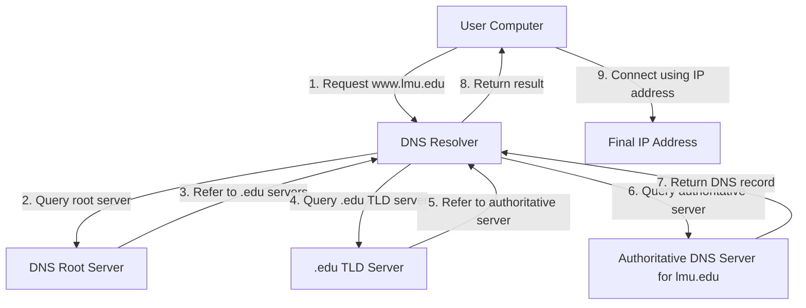
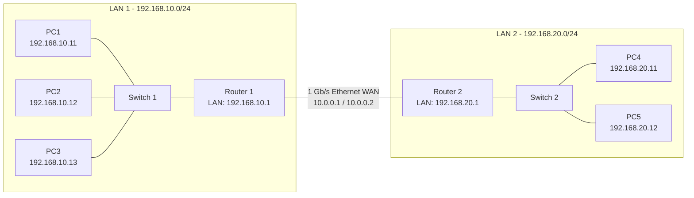

# Tutorial 5

## Task 1: Project Plan

Project Plan

The purpose of the project plan is to organize how my group will communicate, complete tasks, and keep track of our progress throughout the project.

### Communication

Our group will communicate through a **group chat**. We will use the group chat to discuss questions, provide updates, and communicate about the progress of the project.

We will check the group chat regularly and respond when other group members have questions or need information.

### Schedule

Our group plans to work on **one or two tasks each week**. We will share completed work with the group and communicate about any problems or questions that come up.

We will also review the project before the final deadline to make sure that the required tasks have been completed.

### Organization

The project will be organized using the GitHub repository. We will use Markdown files to document our work and include screenshots or other evidence when required.

Our group will communicate about the work that needs to be completed and make sure that the project is updated as we make progress.

---

## Task 2: View Your Cookies

Website Used

**Website:** `https://www.xfinity.com/support/articles/espn-plus-on-x1-flex?msockid=093e9baea089677234848d14a1026694

I used the developer tools in my web browser to view the cookies stored by a website that I regularly visit.

Evidence: Cookies


[Xfinity Cookies](https://github.com/zane-schutzman/IS355/blob/main/images/Tut5/xfinity%20cookies.png) ([image](https://github.com/zane-schutzman/IS355/raw/main/images/Tut5/xfinity%20cookies.png))
I opened the website and used the browser's Developer Tools to view its cookies.

I accessed the cookies by:

1. Opening the website in Microsoft Edge.
2. Right-clicking the webpage and selecting **Inspect**.
3. Opening the **Application** tab in Developer Tools.
4. Selecting **Cookies** from the Storage section.
5. Selecting the website's domain to view its stored cookies.

I did not include the actual cookie values because some cookies can contain sensitive information such as session identifiers or authentication information.

### Information Found in the Cookies

The cookies contained different types of information related to the website and browser session.

Some of the information included:

* **Session information:** Cookies can help the website recognize a user's current browsing session.
* **Login or authentication information:** Some cookies can help maintain a user's signed-in state.
* **Preferences:** Cookies can store settings or preferences for a user.
* **Analytics identifiers:** Some cookies can be used to measure website visits and user activity.
* **Expiration information:** Cookies have expiration dates or can be configured as session cookies.
* **Domain and path information:** This indicates which website or part of a website can use the cookie.

The cookies did not necessarily contain readable personal information. Some values appeared to be randomly generated identifiers used by the website to recognize a browser or session.

### What I Learned

This activity showed me how websites use cookies to store information on a user's computer. Cookies can be used for useful functions such as keeping a user logged in or remembering preferences, but they can also be used for analytics and tracking.

I also learned that cookie values should not be shared publicly because some cookies can contain information that could be used to identify or maintain a user's session.

---

## Task 3: Root Servers

### DNS Root Server

The **DNS Root Servers** are the highest level of the Domain Name System hierarchy. They help DNS resolvers find the servers responsible for different top-level domains.

For this activity, I looked at what happens when a user enters:

```text
www.lmu.edu
```

into a web browser.

### DNS Lookup Process

The DNS lookup process involves several steps.

**Step 1: User enters the website**

The user enters `www.lmu.edu` into a web browser.

**Step 2: Computer contacts a DNS resolver**

The user's computer sends a DNS request to a DNS resolver. The resolver checks whether it already has the requested information stored in its cache.

**Step 3: DNS resolver contacts a root server**

If the resolver does not have the answer cached, it contacts a DNS root server and asks where it can find information about the `.edu` domain.

**Step 4: Root server identifies the `.edu` TLD servers**

The root server does not normally provide the final IP address for `www.lmu.edu`. Instead, it directs the resolver to the DNS servers responsible for the `.edu` Top-Level Domain.

**Step 5: Resolver contacts the `.edu` TLD server**

The DNS resolver contacts a `.edu` TLD server and asks where the DNS information for `lmu.edu` can be found.

**Step 6: TLD server identifies the authoritative DNS server**

The `.edu` server provides information about the authoritative DNS server responsible for `lmu.edu`.

**Step 7: Resolver contacts the authoritative DNS server**

The resolver contacts the authoritative DNS server and requests the DNS record for `www.lmu.edu`.

**Step 8: Authoritative server returns the DNS information**

The authoritative DNS server returns the appropriate DNS record containing the information needed to reach `www.lmu.edu`.

**Step 9: Resolver returns the result**

The DNS resolver sends the result back to the user's computer. The computer can then use the IP address to connect to the website.

### Role of the DNS Root Server

The DNS root server acts as the starting point in the DNS hierarchy when a resolver does not already have the required information cached.

For `www.lmu.edu`, the root server helps direct the DNS resolver toward the `.edu` Top-Level Domain servers. The root server does not normally provide the final IP address of the website. Instead, it helps the resolver find the next level of the DNS hierarchy.

### DNS Resolution Diagram



### What I Learned

This activity helped me understand how DNS translates a domain name into information that a computer can use to connect to a website.

I learned that DNS is organized into a hierarchy consisting of root servers, Top-Level Domain servers, and authoritative DNS servers. The root server helps direct the resolver to the correct TLD server, while the authoritative server provides the DNS information for the specific domain.

---

## Task 4: IP Network Design

### Network Requirements

The network design requires:

* One switched Ethernet LAN containing **three computers**.
* A second switched Ethernet LAN containing **two computers**.
* The two LANs connected using a **1 Gb/s Ethernet point-to-point WAN link**.
* All three networks using **IPv4 with a /24 network mask**.
* Two 8-port Gigabit Ethernet switches.
* Two 2-port routers.
* Five PCs.
* Ethernet cables.

### Network Design

I designed the network using three separate IPv4 networks:

**LAN 1**

```text
192.168.10.0/24
```

**LAN 2**

```text
192.168.20.0/24
```

**WAN**

```text
10.0.0.0/24
```

The first LAN contains three computers connected to Switch 1. Switch 1 connects to Router 1.

The second LAN contains two computers connected to Switch 2. Switch 2 connects to Router 2.

Router 1 and Router 2 are connected using the 1 Gb/s Ethernet WAN link.

---

### IP Address Assignment

| Device   | Interface     | Assigned IP Address | Network |
| -------- | ------------- | ------------------- | ------- |
| PC1      | Ethernet      | `192.168.10.11/24`  | LAN 1   |
| PC2      | Ethernet      | `192.168.10.12/24`  | LAN 1   |
| PC3      | Ethernet      | `192.168.10.13/24`  | LAN 1   |
| Router 1 | LAN Interface | `192.168.10.1/24`   | LAN 1   |
| Router 1 | WAN Interface | `10.0.0.1/24`       | WAN     |
| Router 2 | WAN Interface | `10.0.0.2/24`       | WAN     |
| Router 2 | LAN Interface | `192.168.20.1/24`   | LAN 2   |
| PC4      | Ethernet      | `192.168.20.11/24`  | LAN 2   |
| PC5      | Ethernet      | `192.168.20.12/24`  | LAN 2   |

The subnet mask for all three networks is:

```text
255.255.255.0
```

The switches do not require IP addresses for basic Layer 2 switching.

---

### Default Gateway Configuration

The computers on LAN 1 use Router 1 as their default gateway.

| Computer | IP Address      | Subnet Mask     | Default Gateway |
| -------- | --------------- | --------------- | --------------- |
| PC1      | `192.168.10.11` | `255.255.255.0` | `192.168.10.1`  |
| PC2      | `192.168.10.12` | `255.255.255.0` | `192.168.10.1`  |
| PC3      | `192.168.10.13` | `255.255.255.0` | `192.168.10.1`  |

The computers on LAN 2 use Router 2 as their default gateway.

| Computer | IP Address      | Subnet Mask     | Default Gateway |
| -------- | --------------- | --------------- | --------------- |
| PC4      | `192.168.20.11` | `255.255.255.0` | `192.168.20.1`  |
| PC5      | `192.168.20.12` | `255.255.255.0` | `192.168.20.1`  |

---

### Network Diagram

Evidence: IP Network Design

[Network Diagram](PASTE-YOUR-GITHUB-LINK-HERE) ([image](PASTE-YOUR-RAW-IMAGE-LINK-HERE))



The physical network consists of three computers connected to Switch 1, two computers connected to Switch 2, and the two routers connected through a 1 Gb/s Ethernet WAN link.

---

### Routing Table: Router 1

Router 1 has two directly connected networks and needs a route to LAN 2.

| Destination Network | Next Hop           | Interface |
| ------------------- | ------------------ | --------- |
| `192.168.10.0/24`   | Directly connected | LAN       |
| `10.0.0.0/24`       | Directly connected | WAN       |
| `192.168.20.0/24`   | `10.0.0.2`         | WAN       |

The route to `192.168.20.0/24` tells Router 1 to send traffic for LAN 2 to Router 2 through the WAN link.

---

### Routing Table: Router 2

Router 2 has two directly connected networks and needs a route to LAN 1.

| Destination Network | Next Hop           | Interface |
| ------------------- | ------------------ | --------- |
| `192.168.20.0/24`   | Directly connected | LAN       |
| `10.0.0.0/24`       | Directly connected | WAN       |
| `192.168.10.0/24`   | `10.0.0.1`         | WAN       |

The route to `192.168.10.0/24` tells Router 2 to send traffic for LAN 1 to Router 1 through the WAN link.

---

### How the Network Works

The two LANs are separate IPv4 networks. Computers on LAN 1 use the `192.168.10.0/24` network, while computers on LAN 2 use the `192.168.20.0/24` network.

When a computer needs to communicate with a device on the other LAN, it sends the traffic to its default gateway. Router 1 and Router 2 then use their routing tables to forward the traffic across the WAN connection.

For example, if PC1 needs to communicate with PC4, PC1 sends the traffic to Router 1 at `192.168.10.1`. Router 1 forwards the traffic to Router 2 using the WAN connection. Router 2 then forwards the traffic to PC4 at `192.168.20.11`.

The return traffic follows the reverse path through Router 2, the WAN connection, and Router 1.

---

### Network Testing

After configuring the network, connectivity can be tested using the `ping` command.

For example, PC1 can test the connection to PC4 using:

```text
ping 192.168.20.11
```

PC4 can test the connection back to PC1 using:

```text
ping 192.168.10.11
```

A successful response would show that traffic can travel between the two LANs.

Evidence: Network Connectivity Test

[Ping Test](PASTE-YOUR-GITHUB-LINK-HERE) ([image](PASTE-YOUR-RAW-IMAGE-LINK-HERE))

The ping test can be included as evidence that the two LANs are able to communicate through the routers and WAN connection.

---

## What I Learned

This tutorial helped me understand how DNS, cookies, IP addressing, routing, and network design are connected to real-world networking.

I learned how cookies can store information about a user's browser session and how developer tools can be used to inspect them.

I also learned how DNS uses a hierarchy of servers to resolve a domain name. The root server directs DNS resolvers toward the appropriate Top-Level Domain server, which eventually leads the resolver to the authoritative DNS server.

The IP network design activity helped me understand how multiple networks can be connected using routers. I learned how to assign IPv4 addresses, configure default gateways, divide devices into separate `/24` networks, and create routing tables that allow traffic to move between networks.

---

## Challenges

One challenge was understanding the different levels of DNS servers involved in resolving a domain name. It was important to understand that the root server does not normally provide the final IP address and instead directs the resolver toward the appropriate TLD server.

Another challenge was designing the IP network because the computers needed to be divided into separate networks. I had to make sure that each network had its own `/24` address range and that the routers had the correct interfaces and IP addresses.

Another challenge was understanding the routing tables. I had to determine which networks were directly connected to each router and which network needed to be reached through the other router.

---

## Project Contribution

This tutorial gave me practical experience with several networking concepts, including cookies, DNS resolution, IPv4 addressing, routing, and network design.

The DNS activity helped me understand how domain names are converted into information that computers can use to connect to websites. The network design activity helped me understand how switches and routers work together to connect separate networks.

The IP addressing and routing exercises also helped me understand how routers determine where network traffic should be sent.

---

## Reflection

Overall, this tutorial helped connect networking concepts from class to practical examples.

The cookie activity showed how websites can store information in a user's browser. The DNS activity showed how a domain name such as `www.lmu.edu` can be resolved through multiple levels of DNS servers. The IP network design activity showed how computers, switches, and routers can be organized into separate networks and connected together.

These activities helped me better understand how different parts of computer networking work together to allow devices to communicate across local networks and the Internet.
