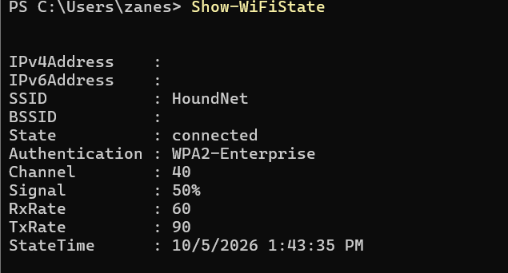

# Tutorial 6: Wi-Fi Details and Access Point

## Task 1: View Wi-Fi Details

For this task, I used PowerShell and the **WiFiTools** module to examine the Wi-Fi networks available around me. I used the following commands:

```powershell
Install-Module WiFiTools -Scope CurrentUser
```

```powershell
Show-WiFiState
```

```powershell
Scan-WiFiAPs
```

```powershell
Show-WiFiInterface
```

```powershell
Get-WiFiLog | Select-Object -First 10
```

### Wi-Fi Access Points Found

The Wi-Fi scan found several different access points. Some of the networks were available on both the 2.4 GHz and 5 GHz bands.

Examples of access points found include:

| SSID     | BSSID               | Frequency Band | Signal |
| -------- | ------------------- | -------------- | -----: |
| eduroam  | `94:64:24:fd:8d:12` | 5 GHz          |    81% |
| HoundNet | `94:64:24:fd:8d:11` | 5 GHz          |    65% |
| Clinical | `94:64:24:fd:8d:14` | 5 GHz          |    81% |

My computer was connected to **HoundNet**. The detailed Wi-Fi interface information showed:

| Setting        | Result              |
| -------------- | ------------------- |
| SSID           | HoundNet            |
| BSSID          | `94:64:24:fd:8d:11` |
| Frequency Band | 5 GHz               |
| Channel        | 153                 |
| Receive Rate   | 180 Mbps            |
| Transmit Rate  | 270 Mbps            |
| Signal         | 81%                 |
| Radio Type     | 802.11n             |
| Authentication | WPA2-Enterprise     |
| Encryption     | CCMP                |

### What I Learned

The Wi-Fi scan showed me that multiple access points can use the same SSID while having different BSSIDs. This can happen when multiple access points are part of the same wireless network.

I also learned that the **2.4 GHz and 5 GHz bands** can be used by the same network. The 5 GHz connection I was using had a channel of **153** and a signal strength of **81%**.

### Evidence

The following screenshot shows the Wi-Fi interface information collected using PowerShell:



The Wi-Fi scan results can also be included as evidence:


---

# Task 2: Use Wi-Fi Access Point

For this task, I explored the settings and features of the **TP-Link Archer C6** wireless router. The Archer C6 is an AC1200 dual-band wireless router that supports both 2.4 GHz and 5 GHz Wi-Fi.

## Important Wi-Fi Network Settings

When designing a Wi-Fi network, there are several important settings to consider. These include **frequency bands, security, speed, coverage, and the number of devices** that will connect to the network.

The Archer C6 supports both **2.4 GHz and 5 GHz** wireless bands. The 2.4 GHz band can provide better coverage, while the 5 GHz band provides faster speeds. The Archer C6 supports speeds of up to **300 Mbps on 2.4 GHz** and **867 Mbps on 5 GHz**.

Security is another important consideration. I would use **WPA3 security** when available because it provides stronger protection for a wireless network and improves password security.

Coverage is also important when designing a Wi-Fi network. The Archer C6 uses **four external antennas and beamforming** to help provide wireless coverage throughout an area. Beamforming can help direct the wireless signal toward connected devices.

The number of devices on the network should also be considered. The Archer C6 supports **MU-MIMO**, which allows the router to communicate with multiple devices at the same time. This can help improve network performance when multiple devices are connected.

The Archer C6 also supports **OneMesh**, which can be used with compatible devices to improve Wi-Fi coverage throughout a larger area.

## Settings I Would Consider

| Setting           | What I Would Use  | Reason                                                          |
| ----------------- | ----------------- | --------------------------------------------------------------- |
| Frequency Band    | 2.4 GHz and 5 GHz | Provides a balance between coverage and speed                   |
| Wireless Security | WPA3              | Provides stronger wireless security                             |
| 2.4 GHz           | Up to 300 Mbps    | Useful for general browsing and devices farther from the router |
| 5 GHz             | Up to 867 Mbps    | Better for higher-speed activities such as streaming            |
| Beamforming       | Enabled           | Helps direct the wireless signal toward connected devices       |
| MU-MIMO           | Enabled           | Helps support multiple devices at the same time                 |
| OneMesh           | Use if needed     | Can improve coverage across a larger area                       |

### Access Point Settings Screenshot

The following screenshot shows the wireless access point/router settings:


---

# Task 3: Continue Your Project

For this task, I continued working on the group networking project in preparation for the draft submission.

The project involves designing a network and considering important areas such as network hardware, IP addressing, cloud services, backups, and cybersecurity.

I continued working on the project by organizing the information collected in the previous tutorials and considering how the networking concepts apply to the proposed network design.

The Wi-Fi information from this tutorial can be used when making decisions about the wireless portion of the network. Important considerations include wireless coverage, frequency bands, security, network capacity, and access point placement.

The project will also include a network diagram, IP address plan, hardware recommendations, cloud services, backup strategies, and cybersecurity controls.

## Project Progress

The group will continue communicating and contributing to the GitHub repository throughout the project. Each member should make regular contributions so that the project shows the progress made by the group.

The draft network design will include:

* Network diagram
* IP address plan
* Recommended networking hardware
* Wireless network design
* Cloud service recommendations
* Backup strategy
* Cybersecurity considerations
* Security controls

## Reflection

This tutorial helped me understand how Wi-Fi networks work in a real environment. I was able to use PowerShell to find nearby access points and examine information about my current wireless connection.

I also learned that designing a Wi-Fi network involves more than just choosing a router. Security, wireless bands, speed, coverage, and the number of connected devices all need to be considered when designing the network.
