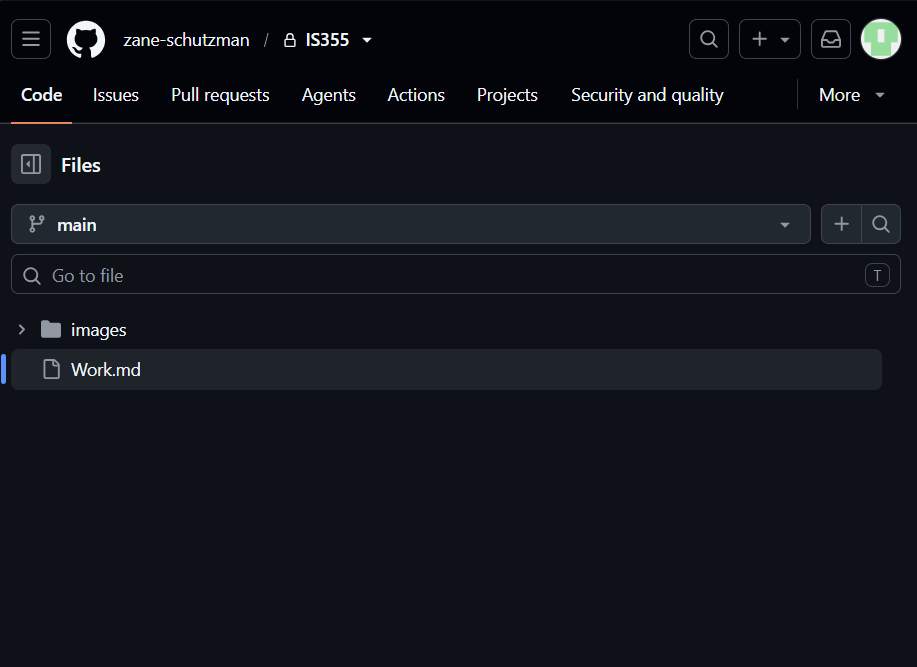
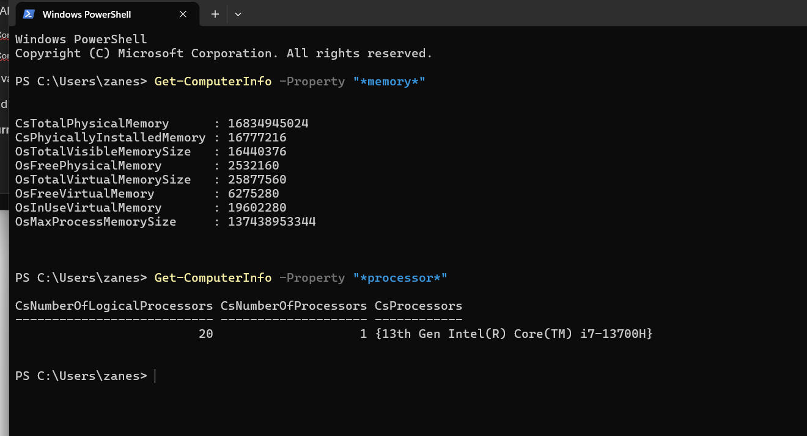
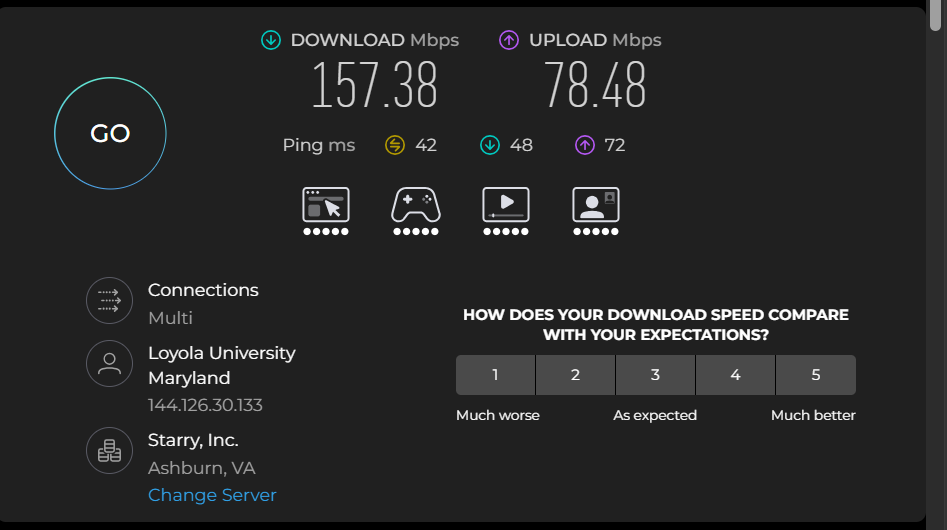
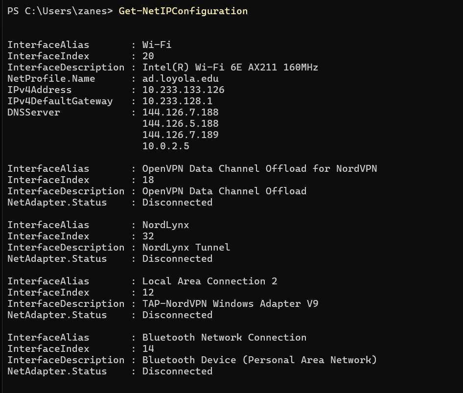
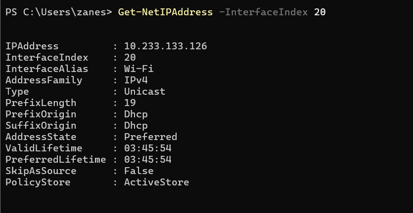
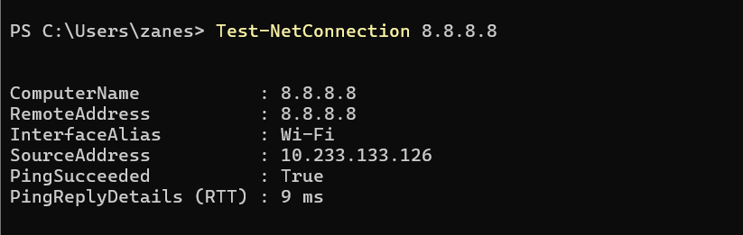
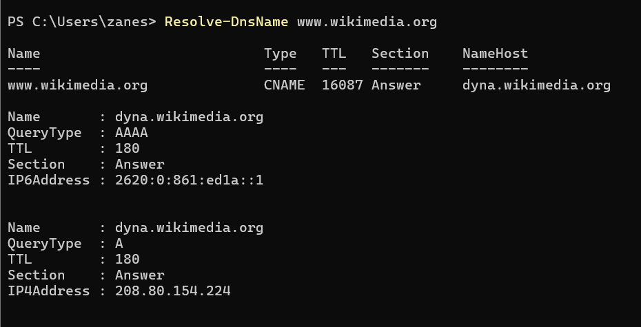
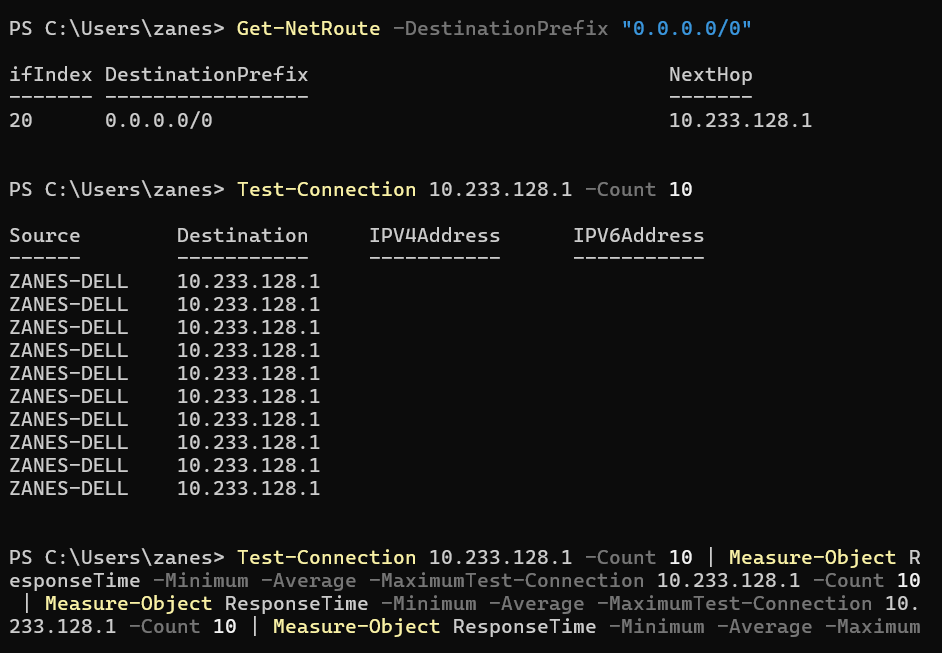

Week 1 - Tutorial 1

Task 1: Start Your GitHub Portfolio


Evidence:


For this task, I set up my GitHub account and created my GitHub profile.

I also created an images directory in my repository, which will be used to store screenshots and other images that provide evidence of my tutorial activities.

Evidence:

Task 2: View Your Computer Information

For this task, I used Windows PowerShell to find information about my computer's hardware and memory.


Evidence:



Commands Used:

I used the following command to view my computer's memory information:

Get-ComputerInfo -Property "*memory*"

I used the following command to view my processor information:

Get-ComputerInfo -Property "*processor*"

My Results:

CsTotalPhysicalMemory        : 16834949024
CsPhysicallyInstalledMemory  : 16777216
OsTotalVisibleMemorySize     : 16440376
OsFreePhysicalMemory         : 2532160
OsTotalVirtualMemorySize     : 25877560
OsFreeVirtualMemory          : 6275280
OsInUseVirtualMemory         : 19602280
OsMaxProcessMemorySize       : 137438953344

Memory Information and Answers:

Total Physical Memory: 16,834,949,024 Bytes

Total Physical Memory: Approximately 16.83 GB

Physically Installed Memory: 16,777,216 KB

Physically Installed Memory: 16 GB

Total Visible Memory: 16,440,376 KB

Free Physical Memory: 2,532,160 KB

Total Virtual Memory: 25,877,560 KB

Free Virtual Memory: 6,275,280 KB

In-Use Virtual Memory: 19,602,280 KB

Maximum Process Memory Size: 137,438,953,344 Bytes

My computer has 16 GB of physically installed RAM. PowerShell reports the total physical memory as 16,834,949,024 Bytes.

Processor Results:

The processor command produced the following results:

CsNumberOfLogicalProcessors : 20

CsNumberOfProcessors        : 1

CsProcessors                : {13th Gen Intel(R) Core(TM) i7-13700H}

Processor Information and Answers

Logical Processors: 20

Physical Processors: 1

Processor: 13th Gen Intel(R) Core(TM) i7-13700H

My computer has 1 physical processor and 20 logical processors. The processor is a 13th Gen Intel(R) Core(TM) i7-13700H.


Operating System and Disk Information:

The tutorial also asks for information about the computer's operating system and disk sizes.

The commands that can be used to find this information are:

Get-ComputerInfo -Property "*os*"

Get-Volume

These commands were not included in my current screenshot, so I have not recorded specific OS or disk values without verifying them.


What I Learned

This tutorial taught me how to begin using GitHub as a portfolio and journal for the IS355 course.

I learned that GitHub repositories can be used to organize my course work and that Markdown can be used to create formatted journal entries. I also learned how to create an images folder and upload screenshots into the repository.

I learned how to use PowerShell to find information about my computer. The Get-ComputerInfo command can display detailed information about different parts of the computer depending on the property specified.

From the commands I ran, I learned that my computer has:

16 GB of physically installed RAM.

16,834,949,024 Bytes of total physical memory.

20 logical processors.

1 physical processor.

A 13th Gen Intel(R) Core(TM) i7-13700H processor.

I also learned that computer memory can be displayed using different units. For example, the physically installed memory was displayed as 16,777,216 KB, which is equivalent to 16 GB.


Challenges

One challenge I experienced was learning how to organize my GitHub repository for the journal.

I needed to create an images directory so that my screenshots could be stored separately from my Markdown file. I learned that GitHub creates a folder when a file is created inside a folder path.

Another challenge was understanding the different memory values returned by PowerShell. The command displayed several different memory measurements, including total physical memory, free physical memory, total virtual memory, and free virtual memory.

At first, these values could be confusing because they are all different numbers. I learned that each value represents a different type or measurement of memory, so I need to pay attention to the property name when recording the results.

I also learned that some values need to be converted into a more understandable format. For example, the physically installed memory is reported as 16,777,216 KB, which is equivalent to 16 GB.


Project Contribution

My main contribution during this tutorial was setting up my individual GitHub portfolio and journal for the IS355 course.

I created the repository and organized it so that I can document my work throughout the unit. I also created an images directory and uploaded screenshots showing evidence of my completed tutorial activities.

This setup will allow me to continue adding my weekly tutorial work, screenshots, commands, results, answers, and project contributions throughout the course.


Reflection

This tutorial helped me become familiar with GitHub and PowerShell.

I learned how to create a GitHub repository and use Markdown to document my course work. I also learned how to organize screenshots in an images folder and include those screenshots in my Markdown journal.

Using PowerShell gave me a better understanding of the hardware in my computer. I was able to find my computer's RAM and processor information using commands instead of manually searching through different Windows settings.

The most useful part of the tutorial was learning how to document the results of the commands I used. Recording the commands, results, screenshots, and explanations will make it easier to show my progress and refer back to what I learned later in the unit.

Overall, I successfully completed the GitHub setup and used PowerShell to find my computer's memory and processor information. I now have a foundation for maintaining my weekly GitHub journal throughout the course.

# Week 2 - Tutorial 2

## Task 1: Speedtest

For this task, I used Speedtest to test the performance of my Internet connection.

Evidence: [wifispeed.png](images/wifispeed.png)



My Speedtest results were:

Download Speed: 157.38 Mbps

Upload Speed: 78.48 Mbps

Ping: 42 ms

The Speedtest also showed a download latency of 48 ms and an upload latency of 72 ms.

The server used for the test was Starry, Inc. in Ashburn, VA.

The connection was identified as Loyola University Maryland.

### What Factors Affect Network Throughput?

Network throughput can depend on several factors.

One factor is the amount of network traffic. If many people or devices are using a network at the same time, the available bandwidth may be shared.

The type of Internet connection can also affect throughput. Different connection types can provide different speeds.

Wi-Fi signal strength can also affect performance. Distance from the router, physical objects, and wireless interference can reduce the quality of a wireless connection.

The number of devices using the network can also affect performance. Devices that are downloading, uploading, streaming, or gaming can use part of the available bandwidth.

The server being connected to can also affect the speed test because the server and the connection between the server and my computer can affect the results.

### What I Learned

I learned that the advertised or available Internet speed does not always mean that I will receive the exact same speed during a speed test.

The speed test measures the actual performance of my connection at that specific time.

I also learned that download speed and upload speed are different. My download speed was 157.38 Mbps, while my upload speed was 78.48 Mbps.

---

## Task 2: Explore Network Maps

For this task, I looked at several websites that provide information about Internet networks and infrastructure.

The tutorial provided the following websites:

Submarine Cable Map:

https://www.submarinecablemap.com/

APNIC Resource Explorer:

https://rex.apnic.net/

AARNet International Network:

https://www.aarnet.edu.au/international-network

Hurricane Electric Network Map:

https://he.net/3d-map/

### Submarine Cable Map

The Submarine Cable Map shows submarine cables that connect different parts of the world.

These cables are important because they allow Internet traffic to travel between different countries and continents.

This showed me that a large amount of Internet communication depends on physical cables.

### APNIC Resource Explorer

The APNIC Resource Explorer provides information about Internet resources.

It can be used to explore information about IP address resources and other Internet networking information.

### AARNet International Network

The AARNet International Network website shows international network connections.

It provides information about how networks can connect different locations around the world.

### Hurricane Electric Network Map

Hurricane Electric is a large Internet service provider.

Its network map shows its global network infrastructure and how different parts of its network are connected.

### What I Learned

I learned that the Internet is made up of many different networks that connect with each other.

I also learned that the Internet depends on physical infrastructure. Submarine cables are one example of physical infrastructure that allows communication between different parts of the world.

---

## Task 3: View a MAC Address with PowerShell

For this task, I used Windows PowerShell to view the network adapters on my computer.

### Commands Used

```powershell
Get-NetAdapter
```

```powershell
Get-NetAdapter -Physical
```

### My Results

The Get-NetAdapter command showed several network adapters on my computer.

My Wi-Fi adapter was:

Name: Wi-Fi

Interface Description: Intel(R) Wi-Fi 6E AX211 160MHz

Interface Index: 20

Status: Up

MAC Address: 98-59-7A-FD-A9-4E

Link Speed: 200 Mbps

The computer also showed the following network adapters:

NordLynx:

Status: Disconnected

Link Speed: 100 Gbps

OpenVPN Data Channel Offload:

Status: Disconnected

Link Speed: 1 Gbps

Bluetooth Network Connection:

Status: Disconnected

MAC Address: 98-59-7A-FD-A9-52

Link Speed: 3 Mbps

Local Area Connection 2:

Interface Description: TAP-NordVPN Windows Adapter V9

Status: Disconnected

MAC Address: 00-FF-B0-35-08-B4

Link Speed: 1 Gbps

### What is a MAC Address?

A MAC address is an address associated with a network adapter.

My Wi-Fi adapter's MAC address was:

98-59-7A-FD-A9-4E

A MAC address is different from an IP address. The MAC address is associated with the network adapter, while the IP address is used for communication on an IP network.

### What I Learned

I learned that my computer has multiple network adapters.

I also learned how to use PowerShell to view information about these adapters.

My Wi-Fi adapter was the active adapter because its status was listed as Up.

I also learned that network adapters can have different MAC addresses and link speeds.

---

## Task 4: View My Computer and Local Router Information

For this task, I used PowerShell to view my computer's network configuration and information about my local router.

### Commands Used

I used:

```powershell
Get-NetIPConfiguration
```

Evidence: [netip.png](images/netip.png)



I also used:

```powershell
Get-NetIPAddress -InterfaceIndex 20
```

Evidence: [netipaddress.png](images/netipaddress.png)



### My Results

My active network interface was Wi-Fi.

Interface Alias: Wi-Fi

Interface Index: 20

Interface Description: Intel(R) Wi-Fi 6E AX211 160MHz

Network Profile: ad.loyola.edu

IPv4 Address: 10.233.133.126

IPv4 Default Gateway: 10.233.128.1

DNS Servers:

144.126.7.188

144.126.5.188

144.126.7.189

10.0.2.5

The Get-NetIPAddress command also showed:

IP Address: 10.233.133.126

Interface Index: 20

Interface Alias: Wi-Fi

Address Family: IPv4

Type: Unicast

Prefix Length: 19

Prefix Origin: Dhcp

Suffix Origin: Dhcp

Address State: Preferred

### What I Learned

I learned how to use PowerShell to find the IP address assigned to my computer.

My computer's IPv4 address was:

10.233.133.126

I also learned that my default gateway was:

10.233.128.1

The default gateway is the network device that my computer uses to communicate with networks outside of the local network.

---

## Task 5: Test Connectivity Between Two Devices

For this task, I tested the connection between my computer and another device on the Internet.

The tutorial explains that this is commonly called a ping.

### Command Used

I used:

```powershell
Test-NetConnection 8.8.8.8
```

Evidence: [netconnection.png](images/netconnection.png)



### My Results

Computer Name:

8.8.8.8

Remote Address:

8.8.8.8

Interface Alias:

Wi-Fi

Source Address:

10.233.133.126

Ping Succeeded:

True

Ping Reply Details (RTT):

9 ms

### What is RTT?

RTT stands for Round Trip Time.

It measures how long it takes for information to travel from my computer to the destination and for the response to return.

My test had an RTT of 9 ms.

The ping succeeded, which means my computer was able to successfully communicate with 8.8.8.8.

### What I Learned

I learned how to use Test-NetConnection to test whether my computer can communicate with another device.

I also learned what RTT means and how it can be used to measure network delay.

My test showed a successful connection with a round trip time of 9 ms.

---

## Task 6: View DNS to IP Mappings

For this task, I used PowerShell to find the DNS information for a website.

### Command Used

I used:

```powershell
Resolve-DnsName www.wikimedia.org
```

Evidence: [websiteaddress.png](images/websiteaddress.png)



### My Results

The DNS lookup showed that:

[www.wikimedia.org](http://www.wikimedia.org)

is a CNAME record that points to:

dyna.wikimedia.org

The DNS results also showed an IPv6 address:

2620:0:861:ed1a::1

The results showed an IPv4 address:

208.80.154.224

### DNS Information

Domain:

[www.wikimedia.org](http://www.wikimedia.org)

CNAME:

dyna.wikimedia.org

IPv6 Address:

2620:0:861:ed1a::1

IPv4 Address:

208.80.154.224

### What is DNS?

DNS stands for Domain Name System.

DNS allows domain names to be associated with IP addresses.

Instead of having to remember an IP address, users can enter a domain name such as [www.wikimedia.org](http://www.wikimedia.org).

The Resolve-DnsName command allows me to view the DNS records associated with a domain.

### What I Learned

I learned how to use PowerShell to find the IP addresses associated with a website.

I also learned that a website can have a CNAME record that points to another domain name.

For [www.wikimedia.org](http://www.wikimedia.org), the CNAME was dyna.wikimedia.org.

The DNS lookup also provided both an IPv4 address and an IPv6 address.

---

## Task 7: Ping My Local Router

For this task, I found the IP address of my local router and tested the connection between my computer and the router.

### Finding the Router

I used:

```powershell
Get-NetRoute -DestinationPrefix "0.0.0.0/0"
```

Evidence: [router.png](images/router.png)



The result showed:

Interface Index: 20

Destination Prefix: 0.0.0.0/0

Next Hop: 10.233.128.1

The next hop of 10.233.128.1 is my local router/default gateway.

### Ping Command

I then used:

```powershell
Test-Connection 10.233.128.1 -Count 10
```

Evidence: [router.png](images/router.png)


The command returned 10 connection attempts to:

10.233.128.1

The source computer was:

ZANES-DELL

### Minimum, Average, and Maximum Delay

The tutorial asks for the minimum, average, and maximum delay between my computer and local router.

The screenshot shows the command that I attempted to use to calculate these values, but the command was entered incorrectly and did not produce the minimum, average, and maximum results.

Because the actual values are not shown in the screenshot, I did not record made-up values.

Minimum Delay: Not recorded in the screenshot

Average Delay: Not recorded in the screenshot

Maximum Delay: Not recorded in the screenshot

### Factors That Can Affect Delay

Several factors can affect the delay between my computer and router.

One factor is Wi-Fi signal strength. Distance from the router can also affect the connection.

Other devices using the network can affect network performance because they may be using bandwidth at the same time.

Wireless interference can also affect the connection.

Network conditions can change over time, which means the delay can also change.

### What I Learned

I learned how to find my local router by looking at the next hop for the default route.

My local router was:

10.233.128.1

I also learned how to use Test-Connection to send multiple ping requests to the router.

I need to make sure that I enter the command correctly if I want PowerShell to calculate the minimum, average, and maximum response times.

---

## Task 8: Find Addresses for a Website

For this task, I selected Wikimedia as the website that I wanted to investigate.

The tutorial asks for as much addressing information as possible about a selected website.

### Website Selected

Website:

[www.wikimedia.org](http://www.wikimedia.org)

### Command Used

I used:

```powershell
Resolve-DnsName www.wikimedia.org
```

Evidence: [websiteaddress.png](images/websiteaddress.png)


### My Results

The DNS lookup returned the following information:

Website:

[www.wikimedia.org](http://www.wikimedia.org)

CNAME:

dyna.wikimedia.org

IPv4 Address:

208.80.154.224

IPv6 Address:

2620:0:861:ed1a::1

### How I Found the Addresses

I used the Resolve-DnsName PowerShell command to look up the DNS information for [www.wikimedia.org](http://www.wikimedia.org).

The command showed that [www.wikimedia.org](http://www.wikimedia.org) has a CNAME record pointing to dyna.wikimedia.org.

The DNS results for dyna.wikimedia.org included both an IPv4 address and an IPv6 address.

### Address Types Found

IPv4 Address:

208.80.154.224

IPv6 Address:

2620:0:861:ed1a::1

CNAME:

dyna.wikimedia.org

### What I Learned

I learned that a website can have several types of addressing information.

The DNS lookup allowed me to find the website's CNAME, IPv4 address, and IPv6 address.

This showed me how DNS information can be used to learn how a website is addressed on a network.

---

## Task 9: Home Internet Connection (Optional)

This task was optional.

The tutorial asks me to find the type of home Internet connection, ISP, data rate, and speed test results at different times.

The Speedtest screenshot from Task 1 shows that my connection was associated with Loyola University Maryland and that the test used Starry, Inc. in Ashburn, VA.

### Available Speedtest Information

Connection/Network Shown:

Loyola University Maryland

Speedtest Server:

Starry, Inc.

Server Location:

Ashburn, VA

Download Speed:

157.38 Mbps

Upload Speed:

78.48 Mbps

Ping:

42 ms

Evidence: [wifispeed.png](images/wifispeed.png)


The screenshot only provides the results from one speed test, so I did not record multiple testing times without additional evidence.

### Why Speed Tests Can Change

Speed test results can change at different times because network conditions can change.

Network congestion can affect the results if more people are using the network.

The number of devices using the network can also affect the available bandwidth.

Wi-Fi signal strength and interference can also affect the speed.

The server being used for the test can also affect the result.

### Speed Test vs. Data Rate

The data rate is the rate associated with the Internet connection.

A speed test measures the actual performance of the connection at the time the test is performed.

The two numbers can be different because the actual performance of a network can change depending on network conditions.

### What I Learned

This tutorial taught me more about computer networking and how devices communicate over a network.

I learned how to use PowerShell to view network adapters and MAC addresses.

I learned that my computer has several network adapters, including Wi-Fi, Bluetooth, and VPN-related adapters.

I also learned how to find my computer's IP address and local router.

My computer's IPv4 address was:

10.233.133.126

My local router/default gateway was:

10.233.128.1

I learned how to use Test-NetConnection to test connectivity to another device. My connection to 8.8.8.8 succeeded and had an RTT of 9 ms.

I also learned how DNS works. Using Resolve-DnsName, I found that [www.wikimedia.org](http://www.wikimedia.org) points to dyna.wikimedia.org and that the DNS information included both an IPv4 and IPv6 address.

The tutorial also helped me understand that the Internet depends on many connected networks and physical infrastructure, including submarine cables.

### Challenges

One challenge I experienced during this tutorial was understanding all of the different networking information shown by PowerShell.

For example, the Get-NetIPConfiguration command showed information about my IP address, default gateway, DNS servers, network profile, and several network adapters.

Another challenge was understanding the difference between a MAC address and an IP address.

I learned that the MAC address is associated with the network adapter, while the IP address is used for communication over an IP network.

The ping activities also required me to understand network delay and RTT.

One issue I experienced was with the Task 7 command used to calculate the minimum, average, and maximum delay. The command shown in my screenshot did not produce those values because it was entered incorrectly.

Because the actual delay values were not shown, I did not make up results. I recorded the router address and the 10 ping attempts that were shown in the screenshot.

### Project Contribution

My main contribution during this tutorial was documenting my networking activities and recording the PowerShell commands and results.

I added evidence from my Speedtest and PowerShell activities.

I documented my MAC address, IP address, default gateway, DNS information, Internet connectivity test, and router information.

I also continued organizing my GitHub portfolio by keeping screenshots in the images directory and documenting the commands and results in Markdown.

This builds on the GitHub portfolio that I created during Tutorial 1.

### Reflection

This tutorial helped me understand networking through hands-on activities.

I learned how to use PowerShell to investigate my own network instead of only learning networking concepts from a textbook.

The MAC address activity helped me understand network adapters and how they are identified.

The IP configuration activity helped me understand how my computer receives an IP address and how the default gateway connects my computer to other networks.

The connectivity test was useful because I was able to test my connection to 8.8.8.8 and see that the ping succeeded with an RTT of 9 ms.

The DNS activity helped me understand how a domain name can be connected to an IP address. I used Resolve-DnsName to find the DNS information for [www.wikimedia.org](http://www.wikimedia.org).

I also learned that the Internet is made up of many networks and physical connections. The network maps showed how networks around the world are connected.

Overall, Tutorial 2 gave me practical experience with networking commands and concepts. I learned how to find network information, test connections, examine DNS records, and document my results using GitHub.

